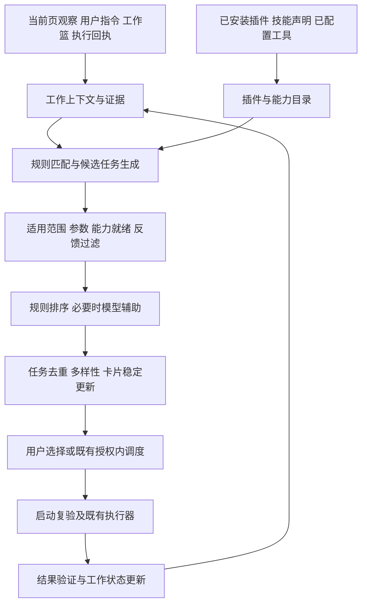

# 协作任务推荐系统设计

状态：设计提案，尚未实现。日期：2026-10-19。

推荐系统根据用户正在处理的对象、当前工作目标和已安装插件的可用能力，提供能推进工作的任务卡片。它统一服务表格、页面分析、阅读学习、多页研究及业务插件，复用既有采集、能力注册、工作流、推理和执行链路。

核心决策：宿主生成并校验候选任务，模型辅助理解工作意图及比较候选；推荐卡片、能力绑定和执行授权独立管理。任何插件都通过同一套合同参与推荐。

## 1. 当前基础和本轮新增设计

| 环节 | 当前基础 | 需要补齐的标准 |
| --- | --- | --- |
| 插件加载 | `Packages` 加载内置包和显式安装包 | 全部来源的统一目录、加载失败和发现覆盖状态 |
| 能力发现 | 包声明、技能能力清单、MCP schema、本机适配绑定 | 统一来源身份、能力版本、就绪状态和变更通知 |
| 工作观察 | 有界页面快照、操作轨迹、选区、表头与表单标签 | 通用工作对象、业务事件、证据身份和有效期 |
| 工作理解 | 目标假设、用户方向、约束、反馈、结果回流 | 结构化工作阶段及目标与对象关联 |
| 候选生成 | 页面匹配、`triggers`、`next`、模型建议 | 通用对象触发、跨插件同任务归并、就绪过滤 |
| 卡片管理 | 建议去重、完成与忽略抑制、待办上限 | 稳定任务身份、排序理由、修订与失效规则 |
| 执行 | 既有能力绑定和工作流执行 | 启动时按最新上下文复验，结果验证驱动接续 |

现有格式及行为见[功能插件标准](adapter-packs.zh-CN.md)、[能力说明](assist-capabilities.zh-CN.md)、[协议](protocol.md)。本提案中的新增字段和事件不能直接作为当前可加载的插件配置。

## 2. 用户体验

工作区保留自然语言输入，下面显示最相关的任务卡片。默认展示最多三张主动推荐，其余放入“更多适合当前工作的任务”；延续现有最多十条自动待办的上限。用户主动建立的任务、进行中任务和结果不参与该截断。

每张卡片显示任务标题、作用对象、为什么现在推荐、预期产物，以及当前可用的执行方式。耗时与成本只有可核实数据时才给数值，否则显示“耗时待确认”“模型用量”或“外部服务成本未知”。

卡片详情提供来源证据、处理范围、缺项、插件与能力来源。主操作依状态显示“开始”“设置参数”“查看进度”或“查看结果”。“稍后”“不相关”“已经完成”分别记录。弱推测任务可以不出现；不要求任何页面都生成卡片。

例如：

```text
合并这两张订单表
对象：工作篮内的两张已确认表格
原因：字段结构相近；你刚将第二张表加入同一项工作
产物：合并表和重复记录清单
执行方式：本机处理
[设置合并规则]  [稍后]
```

字段相似只足以推荐“设置合并规则”，不能据此猜测订单主键并直接合并。

## 3. 一条统一处理链路



推荐链路不运行插件业务代码，不为了排序调用付费查询，也不创建第二套浏览器执行器。模型推理单独统计用量。既有只读体检是独立流程，推荐只消费其回执，不隐式打开页面或调用插件命令。

## 4. 已安装插件与能力目录

### 4.1 来源范围

“所有已安装插件”指当前协作运行时有权读取、且已登记来源中的功能包和工具。它不意味着能自动调用机器上任意程序或其他浏览器扩展的内部功能。

| 来源 | 发现方式 | 何时成为可执行能力 |
| --- | --- | --- |
| 内置和已安装功能包 | 现有包清单、`extension_dirs`、自有 extensions 目录 | 声明校验通过、实现已绑定，并满足当前任务前提 |
| 技能 | 已配置技能根内的能力清单与有限元数据 | 经现有发现确认流程生成有效绑定；描述匹配只算待绑定候选 |
| MCP 工具 | 用户已有配置或宿主交付的工具目录 | 取得完整分页元数据，且本机适配映射已确认、schema 匹配 |
| 本机命令或其他接口 | 功能包中的显式适配声明 | 实现、输入输出合同及适用范围均通过校验 |
| 无声明的已知插件 | 插件安装记录 | 仅在管理页显示“待适配”，不生成可执行卡片 |

沿用现有 `fbl_discovery.py`，不另行扫描未登记目录。发现元数据时不复制认证配置、环境变量或私有命令参数到模型上下文。MCP 新建连接可能启动其服务进程，必须遵循现有发现流程，不能宣称为完全无副作用的文件读取。

MCP 的 `tools/list` 支持分页；支持 `listChanged` 的连接可以通知工具清单变化，未支持时在重连和显式刷新时重新核对。工具 annotations 只作为声明信息，不能代替宿主的行为与授权检查。参见 [MCP 工具规范](https://modelcontextprotocol.io/specification/2025-11-25/server/tools)。

### 4.2 三种记录

| 记录 | 必须包含的内容 |
| --- | --- |
| PluginRecord | 来源命名空间、插件 ID、release、声明摘要、加载状态、发现覆盖状态 |
| CapabilityRecord | 能力 ID、输入输出合同摘要、提供者列表、支持对象与字段、作用范围 |
| BindingRecord | 提供者和实现 ID、版本、传输方式、成本声明、就绪状态、体检时间、限制和并发组 |

插件、能力、实现分别具有身份。例如两个插件都能提供同一表格去重能力，目录保留两个 BindingRecord；推荐页展示同一任务，可在详情选择实现。只有输入输出合同、语义、数据来源要求兼容时才可互换，不能仅按名称相同合并。

能力状态统一为：`ready`、`needs_parameters`、`needs_setup`、`needs_login`、`temporarily_unavailable`、`disabled`、`unknown`。`ready` 只表示当前信息支持尝试执行，不保证服务在线或结果成功。执行授权不编码在这些状态中。

就绪状态按工作区、浏览器上下文、账户范围和实际输入要求求值，不作为全局永久标记；不展示或推断真实凭据。必需步骤全部有兼容实现才算可开始，可选步骤缺失则说明影响。

目录每次有效变更递增 `catalog_revision`。更新采用完整快照原子替换；来源刷新失败保留最后已知记录并标记过期，不把工具临时消失解释为已卸载。明确卸载才撤销对应实现。一个坏包不应导致其余有效插件的推荐全部不可用；核心仍执行现有严格校验，隔离加载失败属于待实现改动。

发现覆盖、元数据有效性和实现体检分别记录，不用一个“已连接”状态代替。第一版采用以下默认策略；时间均由宿主注入，阈值是待真实评估调整的产品默认值：

| 检查项 | 有效规则 | 过期或失败处理 |
| --- | --- | --- |
| 本地包声明 | 当前登记身份及文件摘要一致 | 文件改变、禁用或卸载立即失效，重新校验后发布新快照 |
| 远端工具元数据 | 最近完整分页快照不超过 24 小时，连接身份与合同摘要没有失效信号 | 超时降为 `unknown`；明确变更通知先使受影响来源待刷新 |
| 外部实现体检 | 同一绑定版本、浏览器与账户范围，最近有效体检不超过 10 分钟，且无更新的失败事件 | 降为 `unknown`，需要按现有体检流程刷新；推荐计算本身不启动体检 |
| 纯本地转换 | 当前实现摘要及输入结构检查有效 | 实现或输入改变即重新检查，不依赖远端体检有效期 |

刷新分页中断时不发布半份目录：上一完整快照尚在有效期内且未被撤销的绑定可继续参与推荐，附来源覆盖警告；新出现但未完整确认的工具保持待准备。上一快照过期则全部降为待准备。覆盖不完整始终不能声称“所有插件已就绪”。执行前复验独立进行，不把上述有效期当成执行授权或供应商成功保证。

管理页显示已知插件总数、已注册数、待适配数、加载失败数、刷新未完成来源。分页中断或范围受限时明确标记覆盖不完整，不能报告“已识别所有能力”。

## 5. 工作上下文标准

推荐上下文由宿主从已允许的采集中构建，模型只能提出有证据关联的意图假设。

| 字段 | 含义 |
| --- | --- |
| `work_id / context_revision` | 当前工作身份及观察修订 |
| `user_direction` | 用户明确给出的目标，保留宿主可信来源 |
| `inferred_goal` | 可被修正的目标假设，不覆盖用户方向 |
| `stage` | 浏览、收集、比较、处理、学习、执行或核验；未知允许为空 |
| `subjects` | 当前页、选区、表格、记录、材料集合及其有界摘要 |
| `events` | 对象选中、材料加入、结果就绪、参数修改、用户接管等事件 |
| `evidence` | 证据 ID、类型、来源对象、采集时间、文档/结果修订及有效性 |
| `results / missing` | 已核实进展、部分结果及剩余缺项 |

通用对象先定义 `page`、`text_selection`、`table`、`record_set`、`page_set`、`artifact`；业务对象使用插件命名空间。能力 ID 同样使用命名空间；内置通用语义由核心维护，插件私有类型不会自动等同于核心类型。

每个对象含 `subject_id`、类型、来源引用、修订、覆盖状态和可用字段摘要。正文及大表按需读取，不随每次推荐更新回传。推荐对象引用不是 DOM action ref，更不能作为浏览器权限凭据。

对象证据区分实时引用和用户已收集的材料快照。导航会使实时页面引用、活动选区及 DOM 操作引用失效；用户主动加入工作篮且已取得的有界材料快照继续保留采集修订、来源、时间和覆盖状态，可用于原版本分析或比较，不能据此操作当前网页。原页更新时注明“基于采集时版本”，只有用户刷新材料才读取新内容并递增材料修订。仅收藏 URL/标题而未取得快照的条目标记“待读取”，不能冒充已具备正文或表格；读取仍走当前许可及任务执行路径。用户移除材料、清除工作或撤销对应材料访问时，使依赖它的待执行卡失效。

对象身份使用类型专用规范化：URL 保留有业务意义的路径与查询参数，不统一转小写；表格绑定具体文档和宿主对象身份；多对象任务保留成员身份与必要的顺序。敏感标识的卡片去重键在本机使用摘要，不向模型泄露。

信号优先级为用户指令、明确选区或工作篮对象、已验证结果、页面结构、行为线索。单独停留、滚动或浏览不构成“想学习”“想购买”等确定意图，也不构成执行授权。

沿用现有快照和轨迹上限。只读当前允许观察的页面与用户明确加入的材料，不扩展到任意标签页、浏览历史、表单输入值或跨站后台采集。用户页和任务工作页的观察通路保持分离，避免 Agent 的操作再次触发自己的推荐。

### 5.1 操作到工作上下文的映射

宿主在用户创建工作、主动加入材料或首次取得允许观察的页面时创建 `work_id`。明确创建的新工作始终使用新身份；用户明确方向在其所属工作内保留。被动观察工作只在有确定关系时跨文档延续：相同已核实业务对象、用户选定的同一材料集合，或既有任务的结果关联。仅同域名或相似标题不足以延续。

| 用户操作或系统事件 | 对象和修订变化 | 工作及推荐变化 |
| --- | --- | --- |
| 当前文档首次进入观察 | 新建 page 对象 | 建立被动工作；尚无目标时保留未知 |
| 在同一文档重新选区 | 替换活动选区，旧选区对象过期 | 保留工作，递增上下文修订，撤销依赖旧选区的待执行卡 |
| 将材料加入某个工作篮 | 为该工作新增成员，更新集合修订 | 所选篮的工作保持不变；两张表明确加入同一篮才触发集合比较 |
| 修改筛选、表格刷新 | 保留已核实表格身份，更新内容修订与覆盖 | 同一工作重新求值；旧参数和证据需要复验 |
| 导航到新文档 | 原文档实时页面与活动选区引用失效；已收集快照保留原修订 | 符合上述确定关系则延续；否则建立独立被动工作，不复制原目标 |
| 用户在已有明确工作内打开材料 | 新页面须由用户加入或符合该工作的已核实对象范围 | 原工作保持；无关联页面不自动纳入材料集合 |
| 切换标签页 | 使用当前文档的有效对象映射 | 恢复其关联工作；没有映射则按首次观察处理 |
| 已验证任务产出新结果 | 创建 result/artifact 对象并记录原工作 ID | 更新原工作，不因当前前台标签不同而改归属 |
| 用户更正方向 | 增加可信反馈，更新方向修订 | 保留工作身份，撤销无关待办，执行中任务仍按现有停止机制处理 |
| 用户结束工作或关闭协作 | 撤销主动观察与待调度状态 | 不自动重开或执行；显式恢复时新建观察修订并复验所有对象 |

工作篮与明确工作关系由宿主维护，不由模型生成。重启后的本地记忆只能恢复工作摘要和用户方向，不能恢复旧文档引用、能力就绪或浏览器授权。被动工作之间不自动合并；用户可明确把材料加入已有工作。

## 6. 标准任务描述

TaskDescriptor 是当前目录中的标准推荐任务视图，由包内已有流程和动作投影而来。第一阶段先在内存中生成，不要求旧插件重写声明。

| 内容 | 规则 |
| --- | --- |
| 身份 | 插件内任务 ID、可选核心任务类型、描述版本和执行流程引用 |
| 意图 | 总结、比较、提取、清洗、分析、学习、核对、执行等有限任务标签 |
| 作用对象 | 允许的对象类型、数量、必需字段和覆盖要求 |
| 适用范围 | 专用页面范围或显式通用对象范围 |
| 触发条件 | 既有 `triggers`、用户意图、对象事件或受验证结果驱动的接续 |
| 能力依赖 | 必需/可选能力及各步骤输入输出要求 |
| 参数 | 可确定的输入、待选择的参数、受支持的默认值 |
| 产物 | 表格、分析、笔记、练习、文件、操作回执及相应结果合同 |
| 完成条件 | 哪种可核实回执或产物满足完成；部分和未知如何表示 |
| 行为约束 | 最大对象数量、耗时上限、已有风险声明、执行边界 |
| 推荐策略 | 同任务归并类型、触发理由模板、反馈抑制范围 |

任务匹配分两种范围，不能混用：

1. 专用任务继续要求匹配插件声明的工具、页面、明确业务对象及触发条件。
2. 通用任务必须显式声明通用对象范围，例如“对用户已选中的两张表进行比较”。它不要求特定网站，但仍只消费已允许读取的对象，不因此获得任意站点访问权。

现有 `flows` 默认继续使用专用页面范围。未来新增可选 `flows.<id>.recommendation` 承载上述推荐信息；新增对象参数由宿主适配到现有执行入口。若当前执行入口不能接收相应对象，则该任务保持不可执行，不能退回含糊的自然语言拼接。

推荐合同独立标记 `recommendation_contract: 1`，不代表将当前 `package.json.version` 从 1 静默迁移。实施前需同时更新包校验器、机器 schema、安装检查及文档；不支持新字段的宿主明确拒绝安装并说明需升级。旧包缺省字段继续由现有范围推导。

声明只允许有限事件、比较条件和受支持的 schema 子集，不允许 JS、Python 或任意表达式进入匹配规则。插件描述作为元数据，不作为可覆盖系统指令的提示词。

## 7. 候选生成与排序

### 7.1 候选来源

- 用户输入映射到已注册任务和明确对象。
- 既有页面与选区触发生成确定性候选。
- 通用对象及对象集合事件生成通用任务候选。
- 验证后的结果按 `next` 或明确缺项生成接续候选。
- 模型只在上述任务目录内识别意图、解释歧义或比较候选。

第一版不允许模型即时拼装未声明的跨插件执行图。跨插件组合须有已声明工作流、兼容合同和宿主可验证的步骤映射。无法匹配时保留自由任务入口或显示缺能力，不伪造可执行卡片。

### 7.2 硬过滤

排序前依次检查任务版本、作用范围、对象与证据有效性、触发条件、参数合同、必需能力及绑定限制、当前反馈和重复状态。候选引用必须来自本次目录和上下文，不能由模型发明。

状态处理如下：

| 情况 | 用户界面 |
| --- | --- |
| 明确对象、输入完整、必需能力就绪 | 可开始卡片 |
| 对象明确、实现可用、主键或比较维度待选 | 可配置卡片，主按钮“设置参数” |
| 相关但缺绑定、登录或服务状态未知 | 不占据主推荐；“待准备”最多显示一项及明确原因 |
| 对象不明、过期、范围不符、触发未命中 | 不显示；诊断保留固定原因码 |
| 已执行或已有同任务运行 | 关联已有进度或结果，不新建建议 |

准备卡和参数卡的点击不会自动调用业务能力。显式用户任务即使受阻，也要显示阻碍；不得因推荐过滤而从用户任务列表消失。

### 7.3 初始排序规则

第一版采用可解释的字典序排序，不引入训练排序模型，也不把模型自报置信度当作概率。用户明确请求的任务单列用户任务区域；主动推荐按下列元组逐项升序比较：

`(progress, subject_match, readiness, preference, evidence_age, prior_success, local_cost, latency, task_id)`。

| 项 | 离散值及来源 |
| --- | --- |
| `progress` | 0：解决当前明确目标的已记录缺项；1：验证成功后的声明接续；2：匹配明确对象的一般任务；3：仅弱行为匹配。按最强满足项取值 |
| `subject_match` | 0：当前明确选区；1：用户选定工作篮集合；2：已核实业务对象；3：当前页面结构；4：其他允许的弱线索 |
| `readiness` | 0：输入完整可开始；1：只缺用户参数；其余进入待准备，不参与主卡排序 |
| `preference` | 0：用户显式优先；1：中性；2：用户显式降低优先级。永久禁用在过滤阶段处理 |
| `evidence_age` | 最强有效触发证据年龄：0 不超过 60 秒，1 不超过 10 分钟，2 其余仍有效证据。过期证据已被过滤 |
| `prior_success` | 0：同任务类型、提供者版本及对象类型有宿主验证成功记录；1：没有匹配记录。点击接受和模型自述不算 |
| `local_cost` | 0：宿主可核实的无模型、无外部计费本地操作；1：其他情况。未知不能取 0，也不对不可比的外部报价推断金额高低 |
| `latency` | 同版本及对象规模档的最近有效测量中位数：0 不超过 1 秒，1 不超过 10 秒，2 超过 10 秒，3 无有效测量。只采用最近 7 天的最多 20 条完成记录；规模档按对象数量 1、2–10、11 以上划分 |
| `task_id` | 稳定的宿主任务身份，按字节序打破剩余并列 |

这些都是宿主特征，各项保留证据来源；插件不能自填全局排序分数。模型帮助识别的意图也须关联已有对象及证据，再由宿主计算特征。上述阈值为首版可测试默认值，后续调整必须记录规则版本并回放对比。

展示采用两遍选择：第一遍按排序每个任务类型取一张，第二遍按原序补齐，最多三张；原始合格候选仍保留在更多列表。显式用户任务不应用该多样性限制。

稳定更新以 `ranking_input_digest` 为准：输入包括有效候选及特征、当前时间档、相关反馈、目录修订和经过验证的模型回执。摘要未改变则复用上一展示列表，变化时按同一排序与选择规则重算；不使用未声明的隐藏历史分数。诊断记录摘要和上一展示列表，使回放可重复。仅时间进入新年龄档也算可解释的排序变化。

### 7.4 模型调用边界

规则能确认的触发、输入校验、去重、能力就绪与卡片身份由本地完成。仅在工作意图有歧义或多个相关候选需要语义比较时调用现有推理通道。

模型输入包含有界工作摘要、有效证据 ID、最多二十个候选的精简描述及必要反馈；不每轮注入所有插件正文和全部工具 schema。检索和截断均为宿主执行，并在诊断中记录候选覆盖；截断不能丢掉正在执行或用户明确指定的任务。

模型输出只接受候选 ID、意图假设及证据引用。最终排序、理由渲染和参数映射由宿主验证。回执携带 `work_id`、`context_revision`、`catalog_revision`；旧修订结果丢弃并按最新状态重新计算，不刷新旧卡。

推理失败沿用有效规则候选，并保留已有有效卡片；不阻塞本地工具。新增模型、并行模型评审或模型降级策略都应先由评估证明收益。

## 8. 卡片合同与生命周期

统一卡片记录包含：`card_id`、`work_id`、`task_type`、`descriptor_refs`、`subject_refs`、`context_revision`、`catalog_revision`、`binding_plan_ref`、`state`、`reason_codes`、`evidence_ids`、`output_kind`、`missing_parameters` 和 `blocking_reasons`。UI 标题和说明由受限模板生成；详情可展示更多依据。

`card_id` 由工作身份、标准任务语义、对象身份和会改变业务目标的选项生成。页面修订、提供者和显示文案不进入卡片 ID；它们更新同一卡片的修订。同对象不同目标保留不同卡，例如“检查重复”和“删除重复行”。只有核心已定义等价任务类型或已确认适配映射才跨插件归并。

卡片可处于 `ready`、`needs_parameters`、`blocked`、`queued`、`running`、`completed`、`partial`、`failed`、`outcome_unknown`、`snoozed`、`dismissed`、`stale`。这些是推荐及结果投影，不替代底层浏览器任务状态机。

- 新证据更新原卡，不因标题变化重新创建。
- 对象被移除、来源不再允许、实时文档更换或绑定失效，依赖它的待执行卡标为过期或移除；基于已收集快照的分析卡不因原页导航失效。
- 已启动任务冻结启动时的计划与输入修订；普通切页不把执行中任务从界面删掉。其权限与撤销仍由现有执行器处理。
- 刷新卡片不能恢复已停止任务或重放未知操作。
- 同一对象内容更新但任务已完成时，先标记“结果基于旧版本”，由用户明确刷新；不自动重复执行。

卡片开始前宿主重新取得最新对象、参数、实现版本和授权状态，并按现有路径获取新页面引用。若提供者改变且影响成本、副作用、数据外发或结果口径，应显示新的执行方式；不能以“同一种能力”为由静默替换。

## 9. 结果验证与学习

完成条件按任务类型定义：文件需实际生成且可读，表格需报告范围与缺项，写入需真实回执，分析需有效来源，练习需题目与反馈。模型说“已完成”不是验证证据。

接续建议区分成功、部分、失败和结果未知。现有 `next` 仅对成功回执生效；部分结果可通过新定义的补缺任务接续，但不能伪装成原流程成功。结果未知优先提供核实入口，不推荐重做同一写入。

反馈粒度：

| 反馈 | 影响 |
| --- | --- |
| 稍后 | 暂缓当前工作与对象的任务；默认本工作期间不主动再现，用户可指定时间或手动恢复 |
| 不相关 | 抑制当前工作与对象的任务，重新评估关联意图；不永久禁用整类任务 |
| 方向不对 | 优先修正当前目标，重新生成相关候选 |
| 已经完成 | 显示用户标记完成，独立于宿主验证完成 |
| 接受 | 仅记录尝试意愿 |
| 验证成功、纠偏、接管 | 分别记录实际效果与成本，不把接管一律视为失败 |
| 不再推荐此类 | 按用户明确选择的任务类型与范围长期抑制 |

默认记忆保存任务类型、对象类型、插件来源、反馈类别和结果状态，不保存正文、表格记录或选中文本。继续提供查看、关闭和删除入口；未设置长期偏好时不从一次行为推断永久习惯。

## 10. 通用任务目录与场景示例

以下为待实现的任务目录方向。只有执行器、结果合同和验证器均已接入，才能由 `declared` 转为可推荐任务，不能仅登记名字。

| 当前对象或事件 | 推荐任务 | 前提和产物 |
| --- | --- | --- |
| 单张表格 | 整理、筛选、分组统计、导出 | 表格范围明确；结果表、规则和完整性说明 |
| 两张已选表格 | 比较差异、追加或关联 | 数量明确，主键/列映射待选则先配置 |
| 重复列表或卡片 | 提取结构化记录 | 存在可核实字段；缺字段不补造 |
| 文章或文档页面 | 摘要、基于原文问答、论点分析 | 可读内容明确；结论附来源位置 |
| 明确选中文本 | 解释、翻译、举例 | 只围绕选区，页面是辅助上下文 |
| 用户指定学习目标 | 笔记、自测、错题讲解 | 区分阅读、练习和答题结果；不凭停留推断掌握 |
| 工作篮多个页面 | 多页比较、证据整理、缺项检查 | 用户已选择材料；比较维度相容 |
| 教程页面 | 步骤清单、实践辅助 | 先形成清单；执行按用户指令与现有授权推进 |
| 工单等业务对象 | 插件声明的核对或草稿任务 | 限定业务页面与对象合同，不套用通用文本规则 |
| 结果部分完成 | 补齐缺项、核对覆盖 | 保留已有产物，补缺不重复已完成的写入 |

三个端到端示例：

1. 用户选中一段教程文字 → 推荐解释；明确学习目标后可生成自测；用户回答后针对错误解释并关联原文。不因每次滚动重复弹卡。
2. 用户把两张表加入同一工作篮 → 推荐配置合并与比较；两个插件提供兼容比较能力时归并一张卡；选定主键后执行本地比较，输出差异表与覆盖说明。
3. 用户查看工单 → 现有插件触发材料核对；已验证成功且材料齐全时，按既有 `next` 推荐回复草稿；登录失效则显示原任务受阻，不改走未授权来源。

## 11. 代码落点和迁移

| 模块 | 变更方向 |
| --- | --- |
| `copilot_packages.py`、`copilot_pack_contracts.py` | 投影 TaskDescriptor，校验新增推荐元数据和通用对象范围 |
| `copilot_capabilities.py`、`fbl_discovery.py` | 扩展现有目录投影、就绪与覆盖信息，复用绑定解析和发现 |
| `copilot_observation.py`、`copilot_state.py` | 通用对象与证据身份、上下文修订及事件 |
| `copilot_follow.py` | 统一规则候选入口，保留现有触发语义，集中去重、过滤和排序 |
| `copilot_inference.py` | 接收候选视图，校验模型选择与修订，逐步收敛自由建议路径 |
| `copilot_tools.py`、`copilot_result_actions.py` | 执行前复验、结果状态与接续投影 |
| `copilot_memory.py` | 分开用户偏好、尝试行为与可验证效果 |
| 现有侧栏建议与结果组件 | 三张主卡、参数态、阻碍说明、稳定更新及来源详情 |

先沿用这些模块；只有独立职责确实过大时再提取小模块。不新增数据库、常驻服务、通用 DAG 引擎或第二套插件安装体系。

旧动作映射必须显式处理：

| 旧入口 | 转换和保留边界 |
| --- | --- |
| 有效 `workflow.run` | 由已注册 flow 投影描述，继续执行原对象、页面与触发校验 |
| 已注册内置或包内模板动作 | 以模板 ID 和参数 schema 投影描述，不推断额外步骤或权限 |
| 用户直接输入的 `general.task` | 保留自由任务与原执行限制，单列用户任务，不要求伪装为标准推荐类型 |
| 模型自行生成、无法映射到已注册任务的动作或自由描述 | 不再新增主动卡；诊断记录 `unmapped_task`，用户可主动输入或明确转换为自由任务 |
| 迁移前已存在的待办 | 能映射则复验后保留；无法映射则保留只读内容及“转换为自由任务”入口，不自动派发 |
| 正在执行和已有结果 | 使用原启动合同，保持进度和结果展示，不重新解释为新任务 |

旧包无需重写，但不会保留“模型可任意生成主动自由任务”这一行为；该变化应在启用新推荐引擎时明确说明。第一步先加入投影和只读影子评估，不改变生产推荐；固定场景验收后统一切换候选入口、过滤器与卡片输出，避免同一任务被两个引擎同时展示。

分三步交付：

1. 统一现有插件、任务和候选投影：保持旧包行为，加入目录覆盖、排序理由、同任务归并和修订检查。使用现有动作建立基准。
2. 增加表格、页面、选区和材料集合对象及对应任务合同；补齐执行、产物与验证，再扩展学习和研究任务。
3. 用真实任务回放优化介入时机、偏好和语义排序；MCP 动态通知仅在已有连接可用且协商支持时接入。

按上表将旧确定性建议和可映射旧模型动作转换成同一候选视图，经同一过滤器后展示；迁移验收完成后移除已无调用的重复分支。正在执行的任务保持原合同和启动快照，不在升级时替换计划。

## 12. 验收标准

先保存固定合成场景和排序预期，复用现有测试与 bench 结构。以下必须通过：

1. 固定工作、目录、反馈、注入时间及模型回执后，产生相同候选、顺序和理由码；规则模式无需模型。真实模型输出的稳定性单独评估，不声称模型推理确定性。
2. 新插件完成登记后参与匹配；卸载、禁用和 schema 变化使相关待执行卡失效，其余插件继续可用。
3. 技能描述匹配、未完整确认的新增 MCP 工具和体检过期不会显示成已核实可执行能力；有效旧完整快照可用时仍显示来源覆盖警告。
4. 专用页面外不推荐专用任务；通用任务仅处理明确允许的对象。
5. 两个兼容提供者只生成一张同语义任务卡；不同来源口径、账户范围或副作用不静默互换。
6. 部分数据、空表、零值、缺字段、虚拟列表和过期文档均保留正确覆盖状态。
7. 不相关、稍后、已完成和正在执行的任务不会立即重复出现；用户可主动恢复。
8. 迟到推理结果、插件变更和快速切页不会把旧卡恢复到新工作。
9. 卡片点击和实际派发之间的文档、参数或授权变化会被复验拦截；结果未知不重放。
10. 推荐阶段没有业务工具调用；关闭模型后本地规则及本地任务继续可用。
11. 网页文本和插件描述无法伪造用户方向、能力状态、来源证据或授权。
12. 成功、部分完成、用户标记完成和宿主验证完成可分别读回。
13. 收集第一页快照后导航到第二页，原材料仍能参与多页比较；只有 URL 的条目保持待读取，旧 DOM 引用不能用于新页面操作。

质量指标记录：主卡相关率、无关与重复比例、任务验证完成率、用户纠偏次数、成功任务耗时与用量、无模型推荐占比、目录发现覆盖率，以及卡片列表在无实质变化时的变动次数。点击率单独记录，不作为任务成功率。

离线夹具先验证合同、过滤、排序与竞态；隔离浏览器验证观察、工作页和执行复验；真实模型与实际插件验证意图、延迟、成本和任务结果。三类证据分别记录，设计文档和合成评分均不能替代真实验收。
